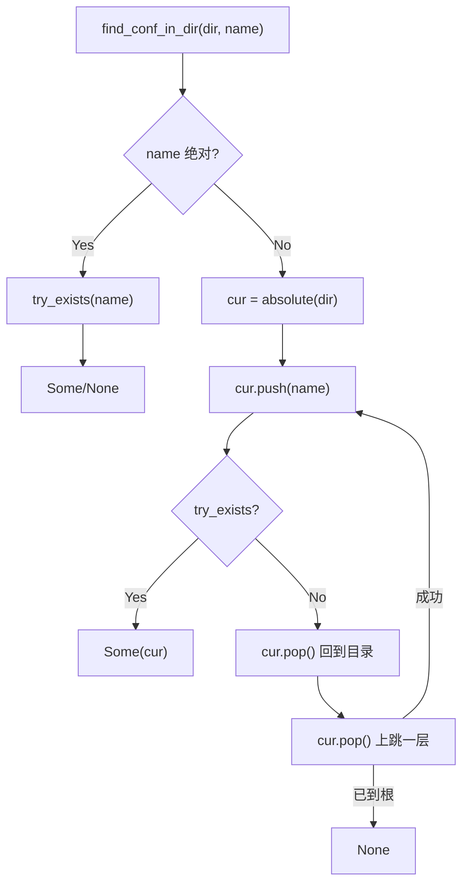

[English](#en) | [中文](#zh)

---

<a id="en"></a>
# find_conf: Walk Up to Find a Config File

- [Overview](#overview)
- [Features](#features)
- [Installation](#installation)
- [Usage](#usage)
- [API Reference](#api-reference)
- [Behavior](#behavior)
- [Error Handling](#error-handling)

- [Overview](#overview)
- [Features](#features)
- [Installation](#installation)
- [Usage](#usage)
- [API Reference](#api-reference)
  - [`find_conf(name: impl AsRef<Path>) -> Result<Option<PathBuf>>`](#find_confname-impl-asrefpath-resultoptionpathbuf)
  - [`find_conf_in_dir(dir: impl AsRef<Path>, name: impl AsRef<Path>) -> Result<Option<PathBuf>>`](#find_conf_in_dirdir-impl-asrefpath-name-impl-asrefpath-resultoptionpathbuf)
- [Behavior](#behavior)
- [Error Handling](#error-handling)
- [About](#about)

## Overview

`find_conf` locates a configuration file or directory by walking upward from a
starting directory, one level at a time, until the filesystem root. It is the
same strategy used by tools like `git`, `eslint`, and `cargo` to discover
project configuration.

If nothing matches all the way to `/`, the function returns `None` instead of
an error.

## Features

- **Upward search**: checks the start directory, then each parent up to the root
- **Two entry points**: process current directory, or any explicit directory
- **Files or directories**: works for `conf.toml`, `.git`, `.env`, and so on
- **Nearest match wins**: the first hit while climbing is returned
- **Zero-allocation climbing**: reuses one `PathBuf` with `push` / `pop`
- **No panics**: all failures surface through `Result`
- **Absolute names respected**: an absolute `name` is checked as-is, once

## Installation

```sh
cargo add find_conf
```

## Usage

```rust
fn main() -> find_conf::Result<()> {
  // Search upward from the current process directory
  if let Some(path) = find_conf::find_conf("conf.toml")? {
    println!("found: {}", path.display());
  }

  // Search upward from a specific directory
  let found = find_conf::find_conf_in_dir("/srv/app/src", ".git")?;
  println!("{found:?}");
  Ok(())
}
```

Typical project layout:

```
/srv/app
├── conf.toml          <- found
└── src
    └── lib
        └── here       <- start directory
```

`find_conf_in_dir("/srv/app/src/lib/here", "conf.toml")` returns
`Some("/srv/app/conf.toml")`.

## API Reference

### `find_conf(name: impl AsRef<Path>) -> Result<Option<PathBuf>>`

Starts at `std::env::current_dir()` and climbs to the root.

### `find_conf_in_dir(dir: impl AsRef<Path>, name: impl AsRef<Path>) -> Result<Option<PathBuf>>`

Starts at `dir` and climbs to the root.

- A relative `dir` is converted to an absolute path with `std::path::absolute`
- A relative `name` is joined to each visited directory
- An absolute `name` is checked directly, without climbing
- The returned path is absolute for relative inputs

Both functions return `Ok(Some(path))` on the first match and `Ok(None)` when
no ancestor contains `name`.

## Behavior



Notes:

- Symbolic links are followed, matching `Path::try_exists` semantics
- Directories and files are both valid matches
- The file is only checked for existence; it is never opened or parsed
- Permission errors and other IO failures are returned, not swallowed

## Error Handling

```rust
pub enum Error {
  Io(std::io::Error),
}
```

The only error source is IO: failing to read the process directory, or failing
to test a candidate path. "Not found" is never an error.

```rust
match find_conf::find_conf("conf.toml") {
  Ok(Some(path)) => println!("{}", path.display()),
  Ok(None) => eprintln!("no conf.toml in any parent"),
  Err(err) => eprintln!("io error: {err}"),
}
```


## About

This library is developed by [WebC.site](https://webc.site).

[WebC.site](https://webc.site): A new paradigm of web development for AI


---

<a id="zh"></a>
# find_conf: 逐级向上查找配置文件

- [概述](#概述)
- [功能特性](#功能特性)
- [安装](#安装)
- [使用方法](#使用方法)
- [API 参考](#api-参考)
- [行为说明](#行为说明)
- [错误处理](#错误处理)

- [概述](#概述)
- [功能特性](#功能特性)
- [安装](#安装)
- [使用方法](#使用方法)
- [API 参考](#api-参考)
  - [`find_conf(name: impl AsRef<Path>) -> Result<Option<PathBuf>>`](#find_confname-impl-asrefpath-resultoptionpathbuf)
  - [`find_conf_in_dir(dir: impl AsRef<Path>, name: impl AsRef<Path>) -> Result<Option<PathBuf>>`](#find_conf_in_dirdir-impl-asrefpath-name-impl-asrefpath-resultoptionpathbuf)
- [行为说明](#行为说明)
- [错误处理](#错误处理)
- [关于](#关于)

## 概述

`find_conf` 从指定目录开始，逐级向上查找配置文件或目录，直到文件系统根目录。
这与 `git`、`eslint`、`cargo` 查找项目配置的策略一致。

若一直找到 `/` 仍无匹配，返回 `None`，而非报错。

## 功能特性

- **向上查找**：依次检查起始目录及其所有父目录
- **两个入口**：进程当前目录，或任意指定目录
- **文件或目录**：适用于 `conf.toml`、`.git`、`.env` 等
- **最近优先**：返回向上过程中第一个命中的路径
- **零额外分配**：复用同一个 `PathBuf`，通过 `push` / `pop` 上跳
- **不 panic**：所有失败通过 `Result` 返回
- **绝对路径直接判断**：`name` 为绝对路径时只检查一次

## 安装

```sh
cargo add find_conf
```

## 使用方法

```rust
fn main() -> find_conf::Result<()> {
  // 从进程当前目录向上查找
  if let Some(path) = find_conf::find_conf("conf.toml")? {
    println!("found: {}", path.display());
  }

  // 从指定目录向上查找
  let found = find_conf::find_conf_in_dir("/srv/app/src", ".git")?;
  println!("{found:?}");
  Ok(())
}
```

典型目录结构：

```
/srv/app
├── conf.toml          <- 命中
└── src
    └── lib
        └── here       <- 起始目录
```

`find_conf_in_dir("/srv/app/src/lib/here", "conf.toml")` 返回
`Some("/srv/app/conf.toml")`。

## API 参考

### `find_conf(name: impl AsRef<Path>) -> Result<Option<PathBuf>>`

从 `std::env::current_dir()` 开始向上查找至根目录。

### `find_conf_in_dir(dir: impl AsRef<Path>, name: impl AsRef<Path>) -> Result<Option<PathBuf>>`

从 `dir` 开始向上查找至根目录。

- `dir` 为相对路径时，用 `std::path::absolute` 转为绝对路径
- `name` 为相对路径时，拼接到每个访问的目录
- `name` 为绝对路径时直接检查，不向上遍历
- 相对输入返回的路径为绝对路径

两个函数均在首次命中时返回 `Ok(Some(path))`，所有祖先目录都不含 `name`
时返回 `Ok(None)`。

## 行为说明


注意：

- 符号链接会被跟随，与 `Path::try_exists` 语义一致
- 文件与目录均可命中
- 只检查存在性，不打开、不解析内容
- 权限错误等 IO 失败会返回 `Err`，不会静默忽略

## 错误处理

```rust
pub enum Error {
  Io(std::io::Error),
}
```

唯一错误来源是 IO：获取进程目录失败，或检查候选路径失败。
"未找到" 永远不是错误。

```rust
match find_conf::find_conf("conf.toml") {
  Ok(Some(path)) => println!("{}", path.display()),
  Ok(None) => eprintln!("所有父目录中都没有 conf.toml"),
  Err(err) => eprintln!("io error: {err}"),
}
```


## 关于

本库由 [WebC.site](https://webc.site) 开发。

[WebC.site](https://webc.site) : 面向人工智能的网站开发新范式

