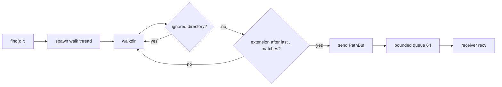

# find_ext: Stream Files by Extension While Walking a Directory

- [Overview](#overview)
- [Features](#features)
- [Installation](#installation)
- [Usage](#usage)
- [API Reference](#api-reference)
- [Ignore Rules](#ignore-rules)
- [Concurrency and Channel](#concurrency-and-channel)
- [Error Handling](#error-handling)

## Overview

`find_ext` walks a directory tree, takes the part after the last `.` in each
file name, and compares it with a given extension set. Matching paths are
streamed through a bounded [`crossfire`](https://crates.io/crates/crossfire)
channel.

Walking runs on its own thread, so callers can process results without waiting
for the whole tree to be scanned. It fits build scripts, code scanning, and
batch processing over many files.

Walking is powered by [`walkdir`](https://crates.io/crates/walkdir); the path
queue is an MPSC bounded channel from `crossfire`.

## Features

- **Streaming**: emit paths while walking, with stable memory use
- **Bounded queue**: fixed capacity of 64; a fast producer blocks instead of piling up
- **Sensible defaults**: skips dot-directories plus `node_modules`, `target`, and other common directories
- **Pluggable policy**: implement `Ignore` or pass a closure
- **Exact extension match**: the part after the last `.`; `a.b.rs` has extension `rs`
- **No symlink following**: avoids loops and escaping the tree
- **No panics**: spawn failures return `Result`; per-entry walk errors are logged and skipped

## Installation

```sh
cargo add find_ext
```

## Usage

```rust
use find_ext::FindExt;

fn main() -> find_ext::Result<()> {
  let finder = FindExt::new(["rs", "toml"]);

  for path in finder.find(".")?.iter() {
    println!("{}", path.display());
  }

  Ok(())
}
```

`Receiver` is a blocking `crossfire` receiver, so you can also loop manually:

```rust
let rx = finder.find("/srv/app")?;
while let Ok(path) = rx.recv() {
  process(&path);
}
```

Custom ignore rules:

```rust
use std::ffi::OsStr;
use find_ext::FindExt;

let finder = FindExt::new_with_ignore(
  ["yaml", "yml"],
  |name: &OsStr| name == "fixtures" || name == "snapshots",
);
```

## API Reference

### `FindExt::new(ext_li: impl IntoIterator<Item = impl AsRef<str>>) -> FindExt`

Creates a finder with the default ignore policy.

Each item in `ext_li` is an extension **without a leading dot**, for example
`["toml", "yml", "yaml"]`. Patterns such as `["*.toml"]` or `[".toml"]` are not
supported.

### `FindExt::new_with_ignore(ext_li, ignore: impl Ignore + 'static) -> FindExt`

Creates a finder with a custom ignore policy. The custom policy **replaces** the
default one; compose with [`DefaultIgnore`](#defaultignore) to keep it.

### `FindExt::find(&self, dir: impl AsRef<Path>) -> Result<Receiver>`

Starts the walk thread and returns the receiver.

- `dir` may be a file or a directory; a file is checked by itself
- The thread is already running when this returns; a closed receiver means the walk finished
- Dropping the receiver closes the queue, and the walk thread exits on its next failed send
- The thread is named `find_ext`

### `Receiver`

```rust
pub type Receiver = crossfire::mpsc::Rx<crossfire::mpsc::Array<PathBuf>>;
```

A blocking receiver. Main methods:

- `recv() -> Result<PathBuf, RecvError>`: block until a path arrives or the channel closes
- `recv_timeout(Duration)`: same, with a timeout
- `iter()`: iterator adapter

## Ignore Rules

Two kinds of directories are skipped by default:

1. Any directory whose name starts with `.`, such as `.git`, `.cache`, `.venv`
2. Common directories listed in [`IGNORE_DIR`]:

```text
node_modules  target  dist  build  out  vendor  bower_components
coverage  Pods  __pycache__  venv  .venv  .git  .hg  .svn  .idea
.vscode  .next  .nuxt  .output  .cache  .turbo  .parcel-cache
.svelte-kit  .docusaurus  .gradle  .terraform
```

Rules apply to directories only, not file names. **The root directory is never
ignored**, so you can start a walk directly at `node_modules`.

Custom `Ignore`:

```rust
use std::ffi::OsStr;
use find_ext::{DefaultIgnore, Ignore};

struct MyIgnore;

impl Ignore for MyIgnore {
  fn ignore(&self, name: &OsStr) -> bool {
    DefaultIgnore.ignore(name) || name == "fixtures"
  }
}
```

`Ignore` is implemented for `Fn(&OsStr) -> bool + Send + Sync`, so closures work
directly.

## Concurrency and Channel



- Capacity is fixed at [`CHANNEL_SIZE`] = 64
- A full queue blocks the walk thread, providing backpressure
- If the receiver is dropped, `send` fails and the walk stops immediately
- Order is whatever `walkdir` yields; it is not sorted

## Error Handling

```rust
pub enum Error {
  Spawn(std::io::Error),
}
```

The only error is failure to create the walk thread. Per-entry walk errors such
as a missing directory or insufficient permissions do not interrupt the walk;
they are logged with `log::debug!` and skipped.

```rust
match FindExt::new(["rs"]).find(".") {
  Ok(rx) => {
    while let Ok(path) = rx.recv() {
      println!("{}", path.display());
    }
  }
  Err(err) => eprintln!("find_ext: {err}"),
}
```
