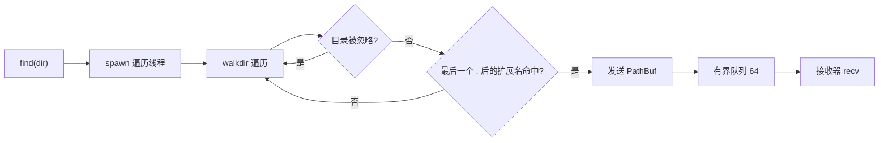

# find_ext: 遍历目录，按扩展名流式查找文件

- [概述](#概述)
- [功能特性](#功能特性)
- [安装](#安装)
- [使用方法](#使用方法)
- [API 参考](#api-参考)
- [忽略规则](#忽略规则)
- [并发与队列](#并发与队列)
- [错误处理](#错误处理)

## 概述

`find_ext` 遍历目录树，把文件名中最后一个 `.` 之后的扩展名与给定集合比对，
命中的文件路径通过 `crossfire` 有界队列流式返回。

遍历在独立线程中执行，调用方无需等全部文件扫描完才能处理结果。
适合在构建脚本、代码扫描、批量处理等场景中消费大量文件路径。

底层使用 [`walkdir`](https://crates.io/crates/walkdir)，
队列使用 [`crossfire`](https://crates.io/crates/crossfire) 的 MPSC 有界通道。

## 功能特性

- **流式返回**：边遍历边发送，内存占用稳定
- **迭代友好**：`Receiver` 实现 `Iterator`，`&Receiver` 也可直接 `for`
- **有界队列**：固定 64 条容量，生产过快时自动阻塞，不无限堆积
- **默认忽略**：跳过 `.` 开头的目录与 `node_modules`、`target` 等常见目录
- **忽略策略独立**：规则来自 [`ignore_dir`](https://crates.io/crates/ignore_dir)，可单独复用
- **可替换策略**：实现 `Ignore` 或直接传闭包，自定义忽略规则
- **静态分发**：忽略策略类型由泛型确定，目录判断无虚调用开销
- **扩展名精确匹配**：取文件名最后一个 `.` 之后的部分，`a.b.rs` 的扩展名是 `rs`
- **不跟随符号链接**：避免循环与越界遍历
- **不 panic**：线程启动失败通过 `Result` 返回，遍历中的单条错误只记录日志

## 安装

```sh
cargo add find_ext
```

## 使用方法

```rust
use find_ext::FindExt;

fn main() -> find_ext::Result<()> {
  let finder = FindExt::new(["rs", "toml"]);

  for path in finder.find(".")?.iter() {
    println!("{}", path.display());
  }

  Ok(())
}
```

`Receiver` 是阻塞接收器，也可以手动循环：

```rust
let rx = finder.find("/srv/app")?;
while let Some(path) = rx.recv() {
  process(&path);
}
```

自定义忽略目录：

```rust
use std::ffi::OsStr;
use find_ext::FindExt;

let finder = FindExt::new_with_ignore(
  ["yaml", "yml"],
  |name: &OsStr| name == "fixtures" || name == "snapshots",
);
```

## API 参考

```rust
pub struct FindExt<I: Ignore = DefaultIgnore> { /* ... */ }
```

### `FindExt::new(ext_li: impl IntoIterator<Item = impl AsRef<str>>) -> FindExt`

创建查找器，使用默认忽略策略。

`ext_li` 中每项是**不含 `.`** 的扩展名，例如 `["toml", "yml", "yaml"]`。
不支持 `["*.toml"]` 或 `[".toml"]` 这类写法。

### `FindExt::new_with_ignore(ext_li, ignore: I) -> FindExt<I>`

创建查找器，使用自定义忽略策略。自定义策略会**完全替换**默认策略，
需要保留默认行为时可组合 [`DefaultIgnore`](#defaultignore)。

重复扩展名会自动去重。`I` 为编译期确定的忽略策略类型。

`Ignore`、`DefaultIgnore`、`IGNORE_DIR` 由 `ignore_dir` crate 提供，
`find_ext` 重新导出，无需额外依赖。

### `FindExt::find(&self, dir: impl AsRef<Path>) -> Result<Receiver>`

启动遍历线程并返回接收器。

- `dir` 可以是文件或目录；是文件时只检查该文件本身
- 扩展名集合为空时直接返回已关闭接收器，不启动线程
- 返回时线程已开始运行，接收器关闭表示遍历结束
- 丢弃接收器会终止队列，遍历线程在下一次发送失败时退出
- 线程名固定为 `find_ext`

### `Receiver`

```rust
pub struct Receiver { /* ... */ }
```

阻塞式接收器，通道关闭后返回 `None`。主要方法：

- `recv() -> Option<PathBuf>`：阻塞直到有路径或通道关闭
- `try_recv() -> Option<PathBuf>`：非阻塞尝试
- `iter() -> Iter<'_>`：借用式迭代
- `IntoIterator`：`Receiver` 与 `&Receiver` 均可直接用于 `for`

## 忽略规则

默认跳过两类目录：

1. 以 `.` 开头的目录，由 `ignore_dir::is_hidden` 统一判断
2. [`IGNORE_DIR`] 中的常见目录：

```text
node_modules  target  dist  build  out  vendor  bower_components
coverage  Pods  __pycache__  venv
```

以 `.` 开头的目录不再逐个配置，`.git`、`.cache`、`.venv` 等自动命中。
规则只作用于目录，不作用于文件名。**根目录永远不忽略**，
因此可以直接把 `node_modules` 作为起点。

自定义 `Ignore`：

```rust
use std::ffi::OsStr;
use find_ext::{DefaultIgnore, Ignore};

struct MyIgnore;

impl Ignore for MyIgnore {
  fn ignore(&self, name: &OsStr) -> bool {
    DefaultIgnore.ignore(name) || name == "fixtures"
  }
}
```

`Ignore` 已为 `Fn(&OsStr) -> bool + Send + Sync` 实现，所以闭包可直接传入。

## 并发与队列



- 容量固定 [`CHANNEL_SIZE`] = 64
- 队列满时遍历线程阻塞，形成背压
- 接收器被丢弃后，`send` 失败，遍历立即停止，不会空转
- 遍历顺序由 `walkdir` 决定，不保证排序

## 错误处理

```rust
pub enum Error {
  Spawn(std::io::Error),
}
```

唯一错误来源是遍历线程创建失败。目录不存在、权限不足等遍历期错误
不会中断整体流程，只通过 `log::debug!` 记录后继续。

```rust
match FindExt::new(["rs"]).find(".") {
  Ok(rx) => {
    while let Some(path) = rx.recv() {
      println!("{}", path.display());
    }
  }
  Err(err) => eprintln!("find_ext: {err}"),
}
```
